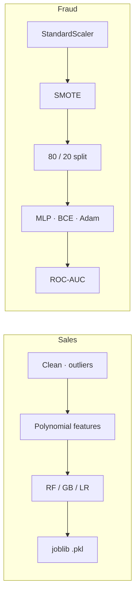

<h1 align="center">🎓 CodSoft Data Science Internship</h1>

<p align="center">Three projects from a 4-week virtual internship (Dec 2024 – Jan 2025): sales regression, Titanic classification and credit-card fraud detection.</p>

<p align="center">
  
  
  
  
</p>

## Projects

| | Notebook | Task | Models | Result |
|---|---|---|---|---|
| 📊 | [`SalesPrediction.ipynb`](SalesPrediction.ipynb) | Sales from TV / radio / newspaper ad spend (200 rows) | Random Forest (tuned) · Gradient Boosting · Linear + polynomial features | **R² 0.96** · MAE 0.84 · MSE 1.14 |
| 🚢 | [`titanic_survival_pred.ipynb`](titanic_survival_pred.ipynb) | Survived or not | Random Forest + GridSearchCV, `FamilySize` feature | Not saved (notebook has no outputs) |
| 💳 | [`CreditCardFraudDetection.ipynb`](CreditCardFraudDetection.ipynb) | Fraud in 284 807 transactions (≈0.17 % fraud) | PyTorch MLP 128 → 64 → 1 + SMOTE | 1.00 reported, but see the issues below |

## Pipelines



## Run it

```bash
pip install numpy pandas scikit-learn seaborn matplotlib joblib imbalanced-learn torch
jupyter notebook
```

The datasets are the public Kaggle ones (Advertising, Titanic, Credit Card Fraud 2013). Download them and fix the `F:\CodSoft\...` paths.

## Status & known issues

| Issue | Effect |
|---|---|
| **Fraud: SMOTE runs before the train/test split** | Synthetic frauds made from the same originals land in both sets, and the test set is 50 / 50 instead of 0.17 % fraud. The perfect 1.00 precision, recall and AUC are leakage, not real performance |
| Titanic notebook was never run | No accuracy to report |
| Datasets not in the repo; paths are hard-coded to `F:\` | Edit before running |
| Sales data has only 200 rows | R² 0.96 on 40 test rows is noisy; use cross-validation |

## Roadmap

- [ ] Fraud: split first, SMOTE on train only, report PR-AUC on the real class ratio
- [ ] Run and save the Titanic notebook
- [ ] `data/` download script and relative paths
